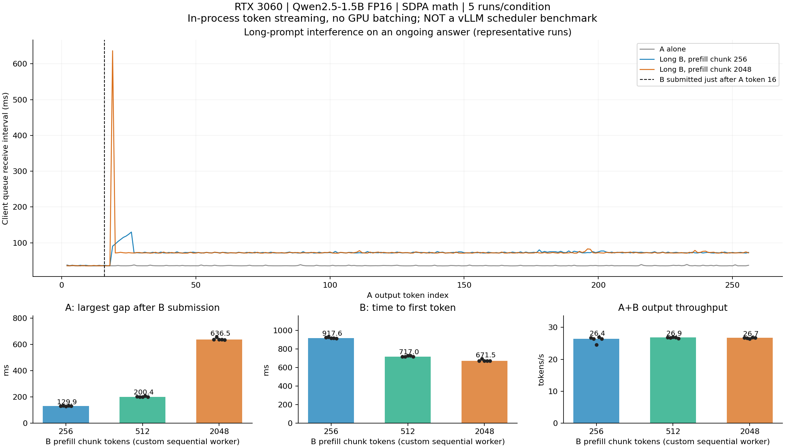

# RTX 3060의 Qwen 스트리밍 간섭 예비 실험

실행일: 2026-11-03 KST. **실제 Qwen2.5-1.5B-Instruct FP16 추론을 실행했다.**
Windows Transformers로 만든 순차 GPU 작업자와 프로세스 내부 큐의 실험이다.
HTTP 서빙, vLLM, continuous batching 실험은 아니다. 아래 chunk 크기를
vLLM의 `max_num_batched_tokens` 값으로 해석하면 안 된다.

## 결과

조건당 5회, 총 25회 측정했다. 표는 중앙값이며 괄호는 5회 최솟값–최댓값이다.
워밍업 3회와 profiler 실행 2회는 제외했다. A 단독의 공백도 16번째 토큰 이후로
계산했다. 이 표의 최대 공백은 개별 실행의 최대값을 구한 뒤 반복 간 중앙값을
취한 것으로, 토큰 간격의 p99가 아니다.

| 조건 | A의 투입 후 최대 수신 공백, ms | B TTFT, ms | 전체 output tokens/s |
|---|---:|---:|---:|
| A 단독 | 39.3 (38.5–41.9) | — | 27.60 (26.97–27.77) |
| 짧은 B, 128 입력 | 81.0 (78.1–103.5) | 112.3 (111.0–133.6) | 27.55 (27.23–27.70) |
| 긴 B, chunk 2,048 | 636.5 (636.0–656.2) | 671.5 (671.0–692.5) | 26.75 (26.40–26.86) |
| 긴 B, chunk 512 | 200.4 (199.5–209.1) | 717.0 (715.7–726.7) | 26.85 (26.51–26.97) |
| 긴 B, chunk 256 | 129.9 (128.7–132.7) | 917.6 (914.1–927.6) | 26.41 (24.55–26.92) |

2,048→256으로 나누면 A의 최대 공백 중앙값은 **79.6% 감소**했고,
B의 TTFT는 **36.6% 증가**했다. 처리량 중앙값은 **1.3% 감소**했지만 반복 범위가
겹치므로 작은 처리량 차이를 확정적인 성능 저하라고 주장하지 않는다.
한 256 조건 실행은 처리량 24.55 tokens/s로 느렸으며, 원인을 확정하지 않고
그대로 포함했다.

이 예비 구현에서는 **512를 절충안**으로 선택할 수 있다. 2,048 대비 A 공백을
68.5% 줄이면서 B TTFT 증가는 6.8%였고 처리량은 비슷했다. 이는 측정 후의
절충 판단이며 사전 설정한 SLA를 충족했다는 뜻은 아니다. A 공백 최소화가
최우선이면 256이 더 적합하다. vLLM 설정 선택에는 별도 검증이 필요하다.

## 무엇을 실행했나

- GPU: NVIDIA GeForce RTX 3060 12 GiB, Windows WDDM, 드라이버 616.92.
- OS: Windows 10 빌드 18363, WSL1. 공식 vLLM Linux GPU 환경이 없어서
  사용자가 Windows 네이티브 예비 실험 경로를 선택했다.
- Python 3.11.18, torch 2.7.0+cu118, CUDA runtime 11.8,
  Transformers 4.51.3. 기존 Conda의 torch를 공유하는 별도 `.venv-llm`에
  추가 의존성을 설치했다. OS 업데이트와 재부팅은 하지 않았다.
- 모델 revision: `989aa7980e4cf806f80c7fef2b1adb7bc71aa306`.
- FP16 가중치·KV, SDPA math backend 고정. math attention의 중간 계산은 FP32다.
  CUDA graph, quantization, prefix cache 재사용은 없다.
- A: 입력 128, 출력 256. B: 입력 128 또는 2,048, 출력 256.
  최대 논리 문맥 2,304. greedy argmax, seed 42, EOS 무시.
- 입력은 반복 영문 문서를 토큰화해 정확한 길이로 자른 합성 completion prompt다.
  실제 사용자 문서나 chat-template 응답 품질 평가는 아니다.
- 모든 입력 token ID 배열을 미리 GPU에 올린다. 모델 로딩, 토큰화, 입력 전송은
  요청 지연에서 제외한다. 매 forward의 GPU 완료 동기화와 finite-logit 검사 비용은 포함한다.
- GPU 작업자는 A와 B의 독립 KV cache를 유지한다. 한 라운드에서 A를 진행하고
  B를 진행한다. 각각 decode 한 토큰 또는 prefill 한 chunk를 처리한다.
  두 요청을 하나의 GPU batch로 합치지 않는다.
- 별도 클라이언트 스레드가 명시적인 token ID를 큐로 받는다. A#16 수신 직후 B를
  제출한다. 같은 `perf_counter_ns` 시계로 송신·admission·forward·생성·수신을 기록한다.
- 짧은 입력은 모든 chunk 후보보다 작으므로 A 단독과 짧은 B는 2,048 조건으로만
  측정했다. 긴 B는 256/512/2,048 세 조건이다. 5개 조건을 seed 42로 섞은 블록을
  5번 실행했다. 실제 순서는 [order.json](results/llm_native_sdpa/order.json)에 있다.
- TTFT는 클라이언트 제출부터 첫 token ID 수신까지다. 처리량 분모는 A 제출부터
  마지막 작업자 완료 이벤트까지이며, 모델 생성 외 네트워크 전송 비용은 없다.

## 측정 유효성

최종 측정 25회에서 45개 요청이 모두 256토큰을 완료했다. 총 **11,520 출력 토큰**이다.
모든 forward에서 logits 유한값 검사를 통과했다. A의 출력 token ID hash는
모든 조건에서 같았고, 긴 B의 hash도 세 chunk 조건에서 같았다.

원시 로그 검증은 입력 토큰 합계 128/2,048, 요청당 255 decode forward와 첫 prefill
출력 1개, 중복·누락 없는 출력 인덱스 1–256, 수신 시각 순서를 확인했다.
모든 B가 A의 마지막 토큰 생성 전에 도착했다. A#16 수신부터 B 제출까지 최대
0.005ms였고, 생성부터 큐 수신까지 최대 지연은 전체 측정에서 2.9943ms였다.

전체 prefill과 chunked cached prefill의 마지막 logits를 별도로 비교했다.
256/512의 최대 절대 차이는 각각 0.03125/0.0283203125였고,
`atol=0.15, rtol=0.02` 비교 및 첫 생성 토큰 일치를 통과했다.
KV 길이는 두 경우 모두 2,048이었다. 검증은 [cache_validation.json](results/llm_native_sdpa/cache_validation.json)에 있다.

PyTorch peak allocated는 최대 **3,568.7 MiB ≈ 3.485 GiB**였다.
이는 CUDA context·Windows 화면 사용량 등을 포함한 전체 VRAM 사용량과 다르다.
1.5B를 그대로 사용했으며 0.5B로 축소하지 않았다.

초기 eager FP16 smoke는 token ID 0만 반복했고 후속 검사에서 NaN logits가
발견되어 **무효 처리**했다. 당시 533ms를 포함한 모든 성능 수치는 제외했다.
실패 원인을 특정 CUDA 연산의 overflow로 확정하지는 않았다. attention backend를
SDPA math로 바꾼 뒤 유한값·cache 비교를 검증하고 모든 조건을 새로 실행했다.
[무효 기록](results/llm_native_smoke/INVALID.json)을 보존했다.

## 원인을 어디까지 좁혔나

비프로파일 실행의 동일 시계 로그에서, 대표 2,048 조건의 A#19 수신 공백
636.53ms 안에 **B prefill 599.00ms와 A decode 37.39ms**가 겹친다.
대표 256 조건의 최대 공백 129.92ms 안에는 **B prefill chunk 93.80ms와
A decode 35.95ms**가 겹친다. 이는 단순한 큐 수신 지연만으로 설명되는 현상이 아니다.

차이가 가장 큰 두 조건만 Torch profiler로 따로 수집했다. 12 forward 대기,
2 forward 준비 후 24 forward만 capture하여 A#16 전후를 포함했다.

| 별도 trace | CUDA kernel 이벤트 | B prefill 표식 | 관측 |
|---|---:|---|---|
| chunk 2,048 | 38,396 | 1개, CPU wall 603.18ms | 해당 동기화 구간 안의 CUDA kernel 시간 합 595.00ms, 이후 A decode 재개 |
| chunk 256 | 38,837 | 8개, CPU wall 66.85–97.70ms | 각 prefill 사이에 A decode 표식 존재 |

프로파일러에서 스레드 초기화 경고가 있었으므로 이벤트 내용을 검사했다.
CUDA kernel 및 A/B user annotation이 실제로 존재하는 것을 확인했다.
다만 instrumentation과 trace 내보내기로 프로파일 실행에 약 28–30초 공백까지
생겼으므로 **프로파일 실행의 TTFT·간격·처리량은 최종 통계에 포함하지 않았다.**
커널 실행과 decode 재개의 순서만 근거로 사용한다.

이 결과는 이 구현에서 긴 prefill 작업이 GPU 작업자의 다음 A decode를 지연시키며,
나누어 실행하면 A가 더 자주 진행하지만 B 완료까지 라운드가 더 필요해진다는
설명을 지지한다. vLLM의 queueing 정책, continuous batching, CUDA graph,
FlashAttention의 효과나 HBM bandwidth 병목을 입증한 결과는 아니다.

## 산출물과 재현

- [실험 코드](benchmark_llm_native.py), [집계·그림 코드](analyze_llm_native.py),
  [trace 검사 코드](inspect_llm_traces.py)
- [실제 설정](results/llm_native_sdpa/metadata.json), [고정 입력](results/llm_native_sdpa/inputs.json)
- [요약 CSV](results/llm_native_sdpa/summary.csv), [중앙값·범위 JSON](results/llm_native_sdpa/aggregate.json)
- [원시 로그 검증](results/llm_native_sdpa/measurement_validation.json),
  [trace 검사 결과](results/llm_native_sdpa/trace_validation.json)
- [PNG 그림](results/llm_native_sdpa/interference.png), [SVG 그림](results/llm_native_sdpa/interference.svg)
- 원본 trace 파일명: `profile_long_2048.pt.trace.json`, `profile_long_256.pt.trace.json`.
  큰 trace는 로컬에 보존하되 Git 추적에서 제외했다.

재실행 방법은 [재현 절차](REPRODUCING.md)에 있다. 그림의 대표 실행은 조건별 최대공백
중앙값에 가장 가까운 실행으로 선택했다. 반복 수가 5이므로 p99, 통계적 유의성,
서비스 SLA나 goodput은 주장하지 않는다. 혼합 부하 확장과 실제 vLLM 측정은 미실시다.

## 면접용 60초 설명

“RTX 3060에서 Qwen 1.5B FP16을 실행하면서 짧은 요청의 16번째 출력 직후
긴 입력 요청을 넣었습니다. Windows 환경 제약 때문에 먼저 Transformers로
순차 작업자를 구현한 예비 실험이었습니다. 긴 입력을 한 번에 처리하자 기존
출력의 최대 공백 중앙값이 약 637ms가 됐습니다. 입력과 출력 토큰 수를 고정하고,
NaN 출력이 나온 초기 실행은 제외한 뒤 측정했습니다. 비프로파일 타임라인과
별도 CUDA trace에서 그 공백 안의 긴 prefill 구간 및 decode 재개를 확인했습니다.
입력을 512토큰씩 나누면 공백이 약 200ms로 줄고 새 요청 TTFT는 약 672에서
717ms로 늘어, 이 구현에서는 절충안으로 판단했습니다. 256까지 줄이면 공백은
130ms지만 새 요청 TTFT가 918ms로 늘었습니다. 따라서 설정을 작게 할수록
무조건 좋다고 보기보다 기존 사용자와 신규 사용자의 지연을 함께 비교했습니다.
이 수치를 실제 vLLM 성능으로 주장하지 않고, 다음 단계에서 별도 검증하겠습니다.”

## 공식 참고 자료

- [vLLM GPU 설치 요구사항](https://docs.vllm.ai/en/stable/getting_started/installation/gpu/)
- [PyTorch SDPA math의 FP32 중간 계산 설명](https://docs.pytorch.org/docs/stable/generated/torch.nn.functional.scaled_dot_product_attention.html)
- [고정 revision의 Qwen 설정](https://huggingface.co/Qwen/Qwen2.5-1.5B-Instruct/blob/989aa7980e4cf806f80c7fef2b1adb7bc71aa306/config.json)
