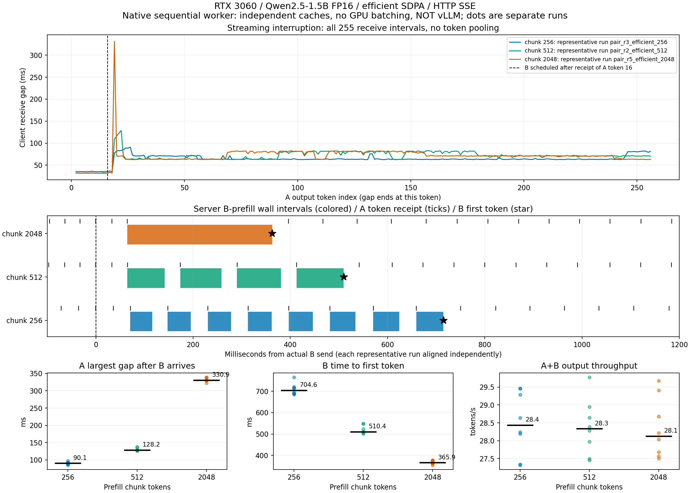
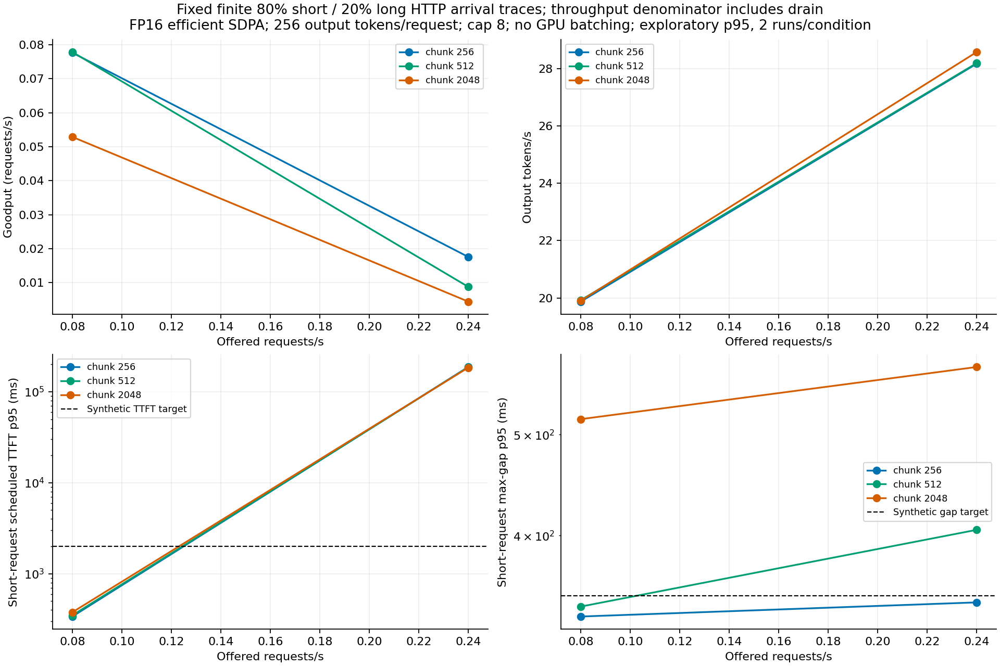
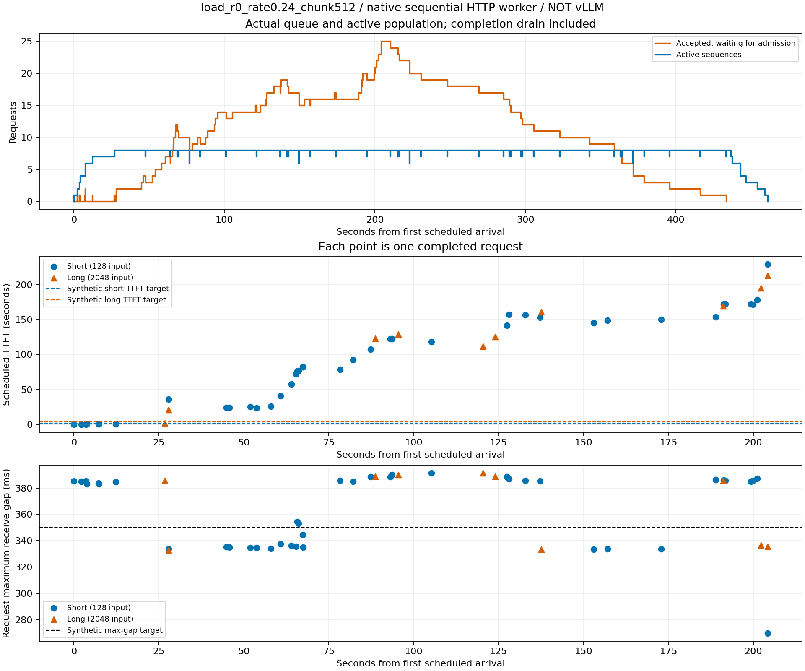
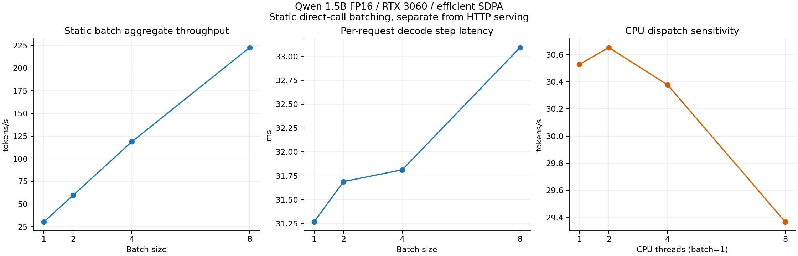
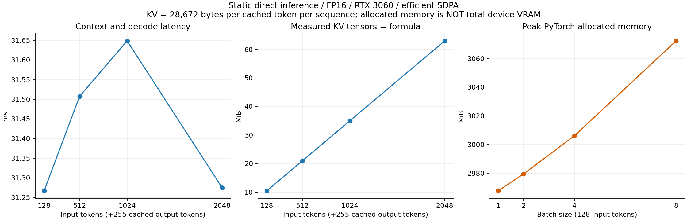

# RTX 3060 LLM 실험 결과 — 2026-11-03

긴 prefill은 이미 스트리밍 중인 요청의 다음 토큰을 지연시켰다. Efficient SDPA와 작은 chunk로
공백을 줄일 수 있었지만, 작은 chunk는 새 요청의 TTFT를 늘렸고 과부하의 입장 대기는 해결하지 못했다.
별도 static batch는 총 처리량을 크게 늘렸으나, HTTP 순차 worker와는 다른 실행 방식이다.

**본 측정209회: HTTP159회·956요청 + static50회·105시퀀스, 출력271,616토큰.**
HTTP 오류0건이며 전체 raw 검증이 통과했다. GPU 작업은06:48:15에 모두 종료됐다.
07:00:18 KST 최종 확인에서 남은 실험 Python 프로세스는0개였다.
[마감 확인 기록](results/overnight/FINAL_DEADLINE_CHECK.json)을 보존했다.
예비 부하4회·50요청, warmup, 수치 probe와 profiler는 이 본 측정 수와 성능 표에서 제외했다.

| 본 측정 cohort | 실행 수 | HTTP 요청 / static 시퀀스 | 반복 설계 |
|---|---:|---:|---|
| HTTP math 대조군 | 25 | 45 | 5조건×5회 |
| HTTP efficient 대조군 | 25 | 45 | 5조건×5회 |
| 혼합부하 | 12 | 600 | 2 rates×3 chunks×2회 |
| Backend crossover | 48 | 96 | 6조건×8블록 |
| Static batch·CPU·context | 50 | 105 | 10조건×5회 |
| Chat prompt | 15 | 30 | 3 chunks×5회 |
| 클라이언트 프로세스 | 30 | 60 | 6조건×5블록 |
| Admission cap | 4 | 80 | 2 caps×2블록 |

전체 수치·hash·SLO 실패 유형·TTFT 분해는 [기계 집계 JSON](results/overnight/RESULTS_DATA.json)에 있다.

## 실험 범위

Windows 10 WDDM, RTX 3060 12 GiB에서 Qwen2.5-1.5B-Instruct를 실제로 추론했다.
모델 revision은 `989aa7980e4cf806f80c7fef2b1adb7bc71aa306`, 가중치와 KV는 FP16,
PyTorch 2.7.0+cu118, Transformers 4.51.3, Python 3.11.18이다.
Windows native 환경을 사용하라는 사용자 선택을 따랐으며 OS 변경·재부팅은 하지 않았다.

서빙 실험은 loopback HTTP/1.1 SSE를 사용하는 **단일 순차 GPU worker**다.
각 요청의 KV cache를 독립적으로 유지하고 round-robin으로 prefill chunk 또는 decode 한 토큰을 처리한다.
**vLLM 실험도, continuous batching 실험도 아니다.** chunk는 요청별 prefill 분할 크기이며
vLLM의 전역 `max_num_batched_tokens`와 동일한 설정으로 해석하면 안 된다.
별도 static batch 실험에서만 여러 시퀀스를 실제 하나의 model forward에 묶는다.

기본 입력은 반복 문서 기반의 합성 completion prompt다. A는 입력128·출력256,
B는 입력128 또는2048·출력256이며 A의 16번째 토큰 수신 직후 B를 제출한다.
Greedy decoding, EOS 무시, 모델 실행 seed42, CUDA graph·prefix cache 재사용 없음이 공통 조건이다.
도착 trace와 조건 순서의 별도 seed는 각 manifest·실행 코드에 보존했다.
모델 로딩·토큰화는 측정 밖이고 HTTP 입력 ID 전송·파싱·GPU 복사는 요청 지연에 포함한다.
매 forward의 full-logit finite 검사와 GPU 동기화 비용도 포함한다.
별도 chat-template 입력 검증은 completion 결과와 합치지 않는다.

전체 설계·반증 조건은 [측정 프로토콜](LLM_OVERNIGHT_PROTOCOL.md), 이전 in-process queue
실험은 [역사적 결과](LLM_NATIVE_RESULTS.md)에 보존했다. 프로파일러 측정치는 이 보고서의 성능 통계에서 제외한다.

## 측정과 검증

SSE의 accepted/token/done/error 이벤트를 구분하고 출력 token ID와 1-based index를 기록한다.
패킷 수·문자 수·read 횟수를 토큰 수로 세지 않는다. 유효한 각 요청은 정확히256개 토큰,
255번 decode, 입력 길이에 맞는 prefill 합계, accepted와 done 이벤트를 가져야 한다.
수신 시각은 이벤트 종료 빈 줄을 읽은 시점이다.

Windows의 시스템 공통 QueryPerformanceCounter 기반 `perf_counter_ns()`를 사용한다.
보고된 시계 해상도는100ns이며 ns 저장 단위가 1ns 정확도를 의미하지 않는다.
서버 forward 구간은 CUDA 완료를 기다린 CPU wall time이므로 GPU kernel 실행시간과 구별한다.

TTFT는 HTTP ingress + admission wait + 입장 후 첫 forward 대기 + prefill forward 합계
+ prefill 사이 교대 대기 + 첫 토큰 전달 시간으로 분해하여 원래 TTFT와 일치하는지 확인한다.
예정 도착 기준 TTFT는 여기에 client send lag를 더한다. A#16 트리거, 실제 A/B 중첩,
동일 도착 trace 재생, 출력 ID의 SHA-256, goodput 분자와 drain 포함 분모도 원시 기록에서 재계산한다.

혼합부하는 짧은 요청80%·긴 요청20%, 요청당 출력256, 조건당50요청×2회다.
조건 간 동일한 도착 trace를 재생하고 두 번째 반복은 순서를 뒤집는다.
합성 SLO는 예정 TTFT≤2초(짧음)/4초(김), 요청별 최대 토큰 수신 간격≤350ms다.
Goodput은 이 조건을 모두 만족한 완료 요청 수 / 첫 예정 도착부터 마지막 완료까지 경과시간이다.
출력 tokens/s에도 drain을 포함한다. .24 requests/s는 유한 과부하 burst이며 정상상태 용량 추정이 아니다.

## 수치 오류부터 제거: eager FP16 NaN

초기 eager FP16 실행은 logits가 NaN이어서 무효화했다. 토큰이 출력됐다는 사실만으로
성능 측정을 유효하다고 취급하지 않았다. 최초 비유한 값은 layer0의 QK 결과에서 관찰됐다.
그 직전 query·key는 모두 finite였고, 같은 Q/K를 FP32로 계산한 최대 절댓값은
264,172.53으로 FP16 유한 최댓값65,504를 넘었다. Scaling 후 FP32 값은23,349.77이었다.
즉 scaling 이후의 이론적 크기가 작더라도 그 이전 FP16 중간값에서 이미 overflow가 발생할 수 있다.
layer1 이후에는 Q/K도 비유한 값으로 전파됐다.

QK·scaling·softmax를 FP32 경로로 제한적으로 바꾸면 FP16 모델의 logits가 finite로 복구됐고,
원래 eager를 BF16으로 실행한 별도 진단에서도 finite였다. 이 관측은 QK 중간 결과의 범위 문제를
강하게 지지한다. CUDA 커널 내부 누산 정밀도를 직접 측정했다는 뜻은 아니다.
BF16 진단은 FP16 latency 표에 포함하지 않는다. Math·efficient SDPA는 지원되지만
설치된 Windows PyTorch 빌드의 FlashAttention은 `No available kernel`로 사용할 수 없었다.

후속 진단에서도 원래 eager FP16은 비유한 값이었지만, **Q를 먼저 scaling한 뒤 QK를 계산하자
FP16 logits가 finite로 복구됐다.** FP32 QK 경로와 Q 사전 scaling 경로의 math SDPA 대비
최대 logit 절대차는 각각0.02734375·0.03515625였다. 유한성 복구를 확인한 것이며,
bitwise 동일성이나 의미적 출력 품질 보장을 주장하지 않는다.

| 진단 경로 | Logits finite |
|---|---|
| 원래 eager FP16 | 아니오 |
| FP16 모델 + QK/scaling/softmax FP32 | 예 |
| FP16 모델 + Q 사전 scaling | 예 |
| 원래 eager BF16, 별도 진단 | 예 |
| math / efficient SDPA, 입력128·2048 | 모두 예 |

근거: [최초 수치 진단](results/overnight/backend_probe/probe.json),
[사전 scaling 포함 재검증](results/overnight/backend_probe_v2/probe.json).

## HTTP 대조군: 긴 prefill의 간섭 재현

각 셀은 조건별5회 실행의 중앙값이다. A 단독은 A#16 이후 최대 간격,
나머지는 B 실제 전송 이후 A의 최대 수신 간격이다. 처리량은 A 또는 A+B 전체 출력 기준이다.

| Backend | 조건 | Chunk | A 최대 간격 ms | B TTFT ms | 출력 tokens/s |
|---|---|---:|---:|---:|---:|
| math | A 단독 | 2048 | 47.85 | — | 26.77 |
| math | 짧은 B 128 | 2048 | 100.32 | 115.84 | 24.46 |
| math | 긴 B 2048 | 2048 | 615.23 | 655.24 | 23.72 |
| math | 긴 B 2048 | 512 | 196.32 | 712.13 | 23.76 |
| math | 긴 B 2048 | 256 | 128.74 | 909.01 | 23.65 |
| efficient | A 단독 | 2048 | 40.89 | — | 31.21 |
| efficient | 짧은 B 128 | 2048 | 80.61 | 92.87 | 29.37 |
| efficient | 긴 B 2048 | 2048 | 345.27 | 378.34 | 29.16 |
| efficient | 긴 B 2048 | 512 | 129.97 | 526.22 | 29.46 |
| efficient | 긴 B 2048 | 256 | 92.96 | 727.96 | 29.68 |

두 cohort는 각각25회·45요청이며 요청 오류0건이다. 동일 backend 안에서는 긴 B가 짧은 B보다
A의 간격을 더 늘리고, chunk를 줄이면 A의 공백이 줄지만 B의 첫 토큰은 늦어진다.
이는 prefill을 더 잘게 번갈아 처리한 결과이며 총 출력 처리량의 큰 증가와 같은 주장이 아니다.
이 표의 backend cohort는 시간대를 나누어 실행했으므로 backend 효과의 주 비교는 뒤의
동일 서버 내 무작위 crossover로 한다.

예를 들어 efficient 첫 반복에서 chunk2048의 A 최대 공백345.27ms에는 B prefill305.57ms와
A decode39.31ms가 겹쳤다. chunk256의 공백92.96ms에는 B prefill57.73ms와
A decode34.87ms가 겹쳤다. 단순 GPU utilization 추정이 아니라 같은 시계의 서버 forward
구간과 클라이언트 공백을 교차 확인한 근거다. 다만 이 구간은 동기화된 wall time이며
순수 GPU kernel 시간으로 해석하지 않는다.

근거: [math 집계](results/overnight/http_pairs_math/aggregate.json),
[efficient 집계](results/overnight/http_pairs_efficient/aggregate.json),
[공백 구간 분해](results/overnight/http_pairs_efficient/gap_attribution.json).

## 같은 서버의 무작위 backend crossover

8개 블록×2 backend×3 chunk, 총48회·96요청을 완료했고 요청 오류는0건이다.
각 블록 안에서 여섯 조건의 순서를 무작위화했다. 아래는 조건별8회 중앙값이다.

| Backend | Chunk | A 최대 간격 ms | B TTFT ms | 출력 tokens/s |
|---|---:|---:|---:|---:|
| math | 256 | 126.14 | 893.26 | 24.01 |
| math | 512 | 191.53 | 695.88 | 23.85 |
| math | 2048 | 601.13 | 639.38 | 24.23 |
| efficient | 256 | 90.15 | 704.59 | 28.44 |
| efficient | 512 | 128.23 | 510.44 | 28.33 |
| efficient | 2048 | 330.94 | 365.88 | 28.13 |

같은 블록·같은 chunk의 efficient/math 변화율을 먼저 계산한 뒤 그 중앙값과 범위를 구했다.
범위는 관측 최솟값–최댓값이며 신뢰구간이 아니다.

| Chunk | A 공백 변화 % 중앙값 [범위] | B TTFT 변화 % | 출력 TPS 변화 % |
|---:|---:|---:|---:|
| 256 | −28.37 [−37.70, −22.32] | −22.19 [−30.57, −14.03] | +15.76 [+13.82, +24.19] |
| 512 | −33.00 [−36.36, −29.49] | −25.99 [−27.72, −21.03] | +17.26 [+12.21, +24.45] |
| 2048 | −44.28 [−46.35, −43.46] | −41.89 [−44.40, −40.95] | +16.26 [+13.57, +24.08] |

모든 paired 블록에서 efficient의 방향이 같았다. 한편 efficient 안에서 chunk2048→256은
A 공백을330.94→90.15ms로 줄였지만 B TTFT를365.88→704.59ms로 늘렸다.
출력 처리량은28.13→28.44 tokens/s로 비슷했다. 따라서 chunk 조절의 주효과는
이 조건에서의 **간섭과 첫 토큰 지연 사이 배분**이다.

두 backend 모두 full2048 prefill 대비 chunk256·512의 cache 길이가2048이고 첫 토큰이 같았다.
최대 logit 절대차는0.03125 이내로 사전 검증 허용오차(atol0.15, rtol0.02)를 통과했다.
전체 greedy 출력 동일성은 별도 output hash 결과로 확인하며, 이 근사 검증만으로 보장하지 않는다.

근거: [crossover 원시 요약](results/overnight/backend_crossover/summaries.json),
[math cache 검증](results/overnight/backend_crossover/cache_math.json),
[efficient cache 검증](results/overnight/backend_crossover/cache_efficient.json).

## 혼합부하: 처리량과 지연 목표는 다른 결과다

12회·600요청·출력153,600토큰을 완료했고 오류는0건이다. 각 행은50요청×2회,
짧은 요청80개·긴 요청20개를 합친 값이다. Goodput과 TPS는 두 실행의 분자 합/경과시간 합으로
계산했으며, 두 실행의 비율을 단순 평균하지 않았다.

| 도착 req/s | Chunk | SLO 충족 /100 | Goodput req/s | 출력 tokens/s | 최대 입장 대기 초 | cap에서 최대 대기 수 |
|---:|---:|---:|---:|---:|---:|---:|
| 0.08 | 256 | 100 | 0.07764 | 19.8758 | 0.6648 | 1 |
| 0.08 | 512 | 100 | 0.07784 | 19.9265 | 0.1782 | 0 |
| 0.08 | 2048 | 68 | 0.05288 | 19.9084 | 3.5707 | 1 |
| 0.24 | 256 | 16 | 0.01761 | 28.1692 | 229.1399 | 25 |
| 0.24 | 512 | 8 | 0.00881 | 28.1899 | 229.3074 | 25 |
| 0.24 | 2048 | 4 | 0.00447 | 28.5760 | 217.7810 | 25 |

저부하에서는 chunk256·512가 두 반복 모두50/50을 충족했고 chunk2048은39/50·29/50이었다.
전체 출력 TPS는 거의 같아, 큰 chunk의 간섭이 처리량 평균에 가려지는 사례다.
평균 도착률0.08에서도 burst에 따라 짧은 cap 대기가 발생했다. 따라서 ‘저부하에서는 대기열이
전혀 없었다’고 해석하면 안 된다.

고부하에서는 TPS가 약28로 높아져도 최대 입장 대기가194–229초 규모였고,
chunk를 줄이는 것만으로 SLO를 회복하지 못했다. SLO 충족 수는 chunk256에서8·8,
512에서0·8, 2048에서0·4로 반복 차이도 있었다. 작은 chunk가 이 고정 trace의 goodput에는
유리했지만, 이것만으로 보편적 최적 chunk나 안정상태 서비스 용량을 결정할 수 없다.
클라이언트 전송 지연 최댓값은 모든 조건에서1.76ms 이하로, 수백 초의 입장 대기를
클라이언트가 제때 전송하지 못한 현상으로 설명하기 어렵다.

근거: [혼합부하 원시 요약](results/overnight/http_mixed_load/summaries.json),
[사전에 고정한 rate 근거](results/overnight/LOAD_RATES_FROZEN.json).
실패 유형을 원시 요청에서 재계산하면 저부하 chunk2048의32개 실패 중31개는 간격 조건만,
1개는 TTFT 조건만 위반했다. 고부하 chunk256의84개 실패 중83개는 TTFT만 위반했고1개는
TTFT와 간격을 함께 위반했다. 반면 고부하 chunk512는 TTFT만39개·간격만8개·둘 다45개,
chunk2048은 각각16개·12개·68개였다. 작은 chunk가 간격을 보호해도 입장 대기까지 해결하는 것은 아니다.

| 도착 req/s | Chunk | 짧은 예정 TTFT 중앙값 초 | 짧은 예정 TTFT p95 초 | 긴 예정 TTFT 중앙값 초 | 짧은 요청 최대 간격 p95 ms |
|---:|---:|---:|---:|---:|---:|
| 0.08 | 256 | 0.188 | 0.339 | 0.968 | 334.33 |
| 0.08 | 512 | 0.198 | 0.349 | 0.688 | 341.78 |
| 0.08 | 2048 | 0.204 | 0.378 | 0.443 | 517.41 |
| 0.24 | 256 | 80.525 | 187.163 | 124.969 | 344.95 |
| 0.24 | 512 | 80.560 | 185.373 | 124.257 | 405.02 |
| 0.24 | 2048 | 78.395 | 184.173 | 118.325 | 580.69 |

각 행의 짧은 요청80개·긴 요청20개는 독립 실행2개 안의 표본이다. p95는 탐색적 기술통계이며
p99나 production tail 보장으로 해석하지 않는다. 두 rate 사이를 측정한 것은 아니므로 그림의
연결선으로 임계 도착률을 추정하지 않는다.

최대 입장 대기 요청은 첫 반복·rate0.24·chunk512의049번 짧은 요청이었다.
예정 TTFT229,585.773834ms는 다음과 같이 정확히 분해됐다.

| 구간 | ms |
|---|---:|
| Client send lag | 1.138334 |
| HTTP ingress | 9.9245 |
| Admission wait | 229307.4297 |
| 입장 후 첫 forward 대기 | 233.3198 |
| Prefill forward wall time | 33.5338 |
| Prefill 사이 교대 대기 | 0.0000 |
| 첫 토큰 전달 | 0.4277 |

입장 대기가 지연의 대부분이고 prefill 자체는33.53ms였다. 평균 TTFT만으로는 이 구분을 놓친다.
아래 queue 그림은 분석 전에 선택해 둔 같은 trial을 사용하며 accepted/admitted/completed 시각으로
실제 대기·active 인원을 복원했다. 그래프 선택은 최댓값 요청을 나중에 고른 것과 구분된다.

## 실제 static batch·CPU·문맥·KV 실험

HTTP 서버와 별도로 model forward에 실제 batch를 넣은10조건×5회, 총50회·105시퀀스,
출력26,880토큰을 완료했다. Batch 안의 입력은 동일 prompt 복제본이다. 서로 다른 길이·도착 시각을
처리하는 continuous batching 성능으로 일반화하지 않는다. 모든 수치는 조건별5회 중앙값이다.

| Batch | 입력 | CPU threads | 총 출력 tokens/s | 요청별 decode step ms | TTFT ms | Peak allocated MiB |
|---:|---:|---:|---:|---:|---:|---:|
| 1 | 128 | 4 | 30.38 | 31.27 | 34.57 | 2967.68 |
| 2 | 128 | 4 | 59.80 | 31.69 | 43.89 | 2979.45 |
| 4 | 128 | 4 | 118.88 | 31.81 | 76.86 | 3006.08 |
| 8 | 128 | 4 | 222.52 | 33.09 | 141.97 | 3072.35 |

Batch1→8의 총 처리량은 약7.33배였지만, 요청별 decode step은31.27→33.09ms,
TTFT는34.57→141.97ms로 늘었다. 이 결과는 여러 시퀀스를 하나의 forward로 묶는 이점을
보여 주지만, HTTP 순차 worker가 같은 batching 이점을 이미 얻었다는 뜻은 아니다.
또한 이 speedup만으로 DRAM bandwidth 병목이 입증되지는 않는다.

| CPU threads, batch1·입력128 | 출력 tokens/s | Decode step ms |
|---:|---:|---:|
| 1 | 30.53 | 31.29 |
| 2 | 30.65 | 31.27 |
| 4 | 30.38 | 31.27 |
| 8 | 29.37 | 32.85 |

1·2·4 threads 차이는 작았고8 threads는 중앙값이 다소 나빴다. ‘CPU thread를 늘리면
GPU 추론이 빨라진다’는 단순 가설은 지지되지 않았다. 이 작은 표본으로2 threads를
보편적 최적값이라고 추천하지 않는다.

| 입력 토큰, batch1·threads4 | 출력 tokens/s | Decode step ms | TTFT ms | 실제 KV MiB | 실제 저장 토큰 |
|---:|---:|---:|---:|---:|---:|
| 128 | 30.38 | 31.27 | 34.57 | 10.4727 | 383 |
| 512 | 29.81 | 31.51 | 77.37 | 20.9727 | 767 |
| 1024 | 28.89 | 31.65 | 145.57 | 34.9727 | 1279 |
| 2048 | 28.86 | 31.28 | 291.79 | 62.9727 | 2303 |

문맥 증가에 따라 TTFT와 KV는 증가했지만 decode step 중앙값은 단조 증가하지 않았다.
특히128→2048의 decode 중앙값은31.27→31.28ms로 거의 같았다. 이 범위에서
‘긴 KV가 decode를 확실히 느리게 했다’는 결론은 지지되지 않는다.

실제 구조는28 layers, KV heads2, head dimension128, FP16 2bytes이므로
토큰·시퀀스당 KV는 `2(K/V) × 28 × 2 × 128 × 2 = 28,672 bytes`다.
50회 모두 실제 K/V tensor bytes가 `28,672 × batch × (입력+255)`와 정확히 일치했다.
마지막 출력 토큰을 다음 forward에 넣기 전에 종료하므로 cache 길이는 입력+256이 아닌 입력+255다.
논리 문맥2304의 KV 상한은 시퀀스당63MiB이며, 실제2303토큰 cache는62.9727MiB다.

고유 파라미터1,543,714,304개의 FP16 가중치는3,087,428,608bytes다.
가중치와 KV만 더한 값에는 activation·allocator·CUDA context·Windows 화면 메모리가 빠진다.
위 peak allocated 역시 장치 전체 VRAM과 동일하지 않다.

근거: [static 실험 요약](results/overnight/static_batch_fp16/summaries.json).

## Chat prompt에서의 재현

System/user/assistant role delimiter를 포함한 정확히128·2048토큰 입력으로,
efficient SDPA에서 세 chunk×5회, 총15회·30요청을 완료했다. 오류는0건이다.

| Chunk | A 최대 간격 ms | B TTFT ms | 출력 tokens/s |
|---:|---:|---:|---:|
| 256 | 88.89 | 710.85 | 29.04 |
| 512 | 128.00 | 507.30 | 28.24 |
| 2048 | 322.90 | 358.24 | 28.33 |

Chunk를 줄일 때 A 공백이 감소하고 B TTFT가 증가하는 방향은 chat 입력에서도 재현됐다.
다만 한 종류의 합성 chat prompt이며 실제 사용자 질의 분포나 의미적 답변 품질 평가는 아니다.
Completion cohort와 표본을 합치지 않았다.

근거: [chat 실험 요약](results/overnight/chat_pairs/summaries.json).

## 클라이언트를 별도 프로세스로 분리해도 재현되는가

같은 persistent GPU 서버에서 클라이언트 위치×3 chunk를 블록 내 무작위 순서로5회 반복했다.
총30회·60요청을 완료했고 오류는0건이다. 별도 클라이언트 프로세스는 CUDA를 초기화하지 않는다.
두 위치 모두 실제 loopback HTTP를 사용한다.

| 클라이언트 위치 | Chunk | A 최대 간격 ms | B TTFT ms | 출력 tokens/s |
|---|---:|---:|---:|---:|
| 서버 프로세스 내부 | 256 | 87.41 | 690.20 | 27.59 |
| 서버 프로세스 내부 | 512 | 127.04 | 507.79 | 28.14 |
| 서버 프로세스 내부 | 2048 | 325.73 | 359.15 | 29.04 |
| 별도 프로세스 | 256 | 93.72 | 736.52 | 29.21 |
| 별도 프로세스 | 512 | 130.06 | 518.44 | 28.47 |
| 별도 프로세스 | 2048 | 329.79 | 365.86 | 27.78 |

분리해도 긴 chunk의 약330ms 공백과 작은 chunk의 TTFT 비용이 유지됐다.
따라서 이 큰 간섭 현상을 서버와 클라이언트가 같은 Python 프로세스를 공유한 탓만으로
설명하기 어렵다. 그렇다고 클라이언트 위치 영향이 정확히0이라는 뜻은 아니다.
Paired A 공백 변화율 중앙값은 chunk256/512/2048에서 각각+7.00%/−0.23%/+1.14%였고,
범위는[+0.15,+9.01]/[−3.75,+5.06]/[−1.28,+3.11]%였다.
TPS 변화율 중앙값은+4.47/+1.25/−4.33%로 방향이 일정하지 않았다.
소수 반복·Windows desktop 조건에서 위치 변경의 보편적 성능 개선을 주장하지 않는다.
요청별 ‘생성→수신 최대 지연’의 중앙값은 내부0.4814ms·별도0.4492ms,
전체 관측 최댓값은0.6529ms·0.5183ms였다. 수백 ms의 prefill 공백보다 훨씬 작았다.

근거: [프로세스 교차 실험 요약](results/overnight/client_process_crossover/summaries.json).

## Admission cap: active 수를 줄이면 대기는 어디로 이동하는가

Efficient·chunk512·rate0.24에서 cap2와8을20요청씩 두 블록으로 교차했다.
두 번째 블록은 순서를 뒤집었다. 총4회·80요청, 오류0건이다. 각 cap은40요청
(짧음32·김8)이므로 본50요청 혼합부하와 합치지 않는다.

| Active cap | SLO 충족 /40 | Goodput req/s | 출력 tokens/s | 짧은 예정 TTFT 중앙값 초 | 짧은 최대 간격 중앙값 ms | 최대 입장 대기 초 |
|---:|---:|---:|---:|---:|---:|---:|
| 2 | 4 | 0.01124 | 28.7798 | 50.556 | 82.75 | 84.100 |
| 8 | 12 | 0.03376 | 28.8072 | 21.969 | 326.46 | 61.988 |

Cap2는 active 요청의 간격을 줄였지만 입장 대기를 늘렸다. 전체 TPS는 거의 같은데 goodput은
더 낮았다. Cap2의36개 실패는 모두 TTFT만 위반했고, cap8은 TTFT만24개·간격만4개였다.
순차 worker에서 active cap은 GPU batch size가 아니다. Cap 축소는 기다릴 위치와 교대 빈도를
바꾸지만, 이 burst에서 처리 용량 자체를 늘리지 못했다. 긴 요청8개·반복2회로 tail 보장은 하지 않는다.

근거: [admission cap 집계](results/overnight/admission_crossover/aggregate.json).

## 최종 검증과 산출물

[집계 스크립트](summarize_llm_study.py)가 모든 완료 cohort의 raw/index 개수를 확인하고
[HTTP 검증기](analyze_llm_http.py)를 다시 실행했다. 정확히256개 토큰·255 decode·prefill 길이,
A#16 트리거·실제 중첩, arrival trace, SHA-256, TTFT 분해, SLO 개수, drain 분모 검증이 모두 통과했다.
각 HTTP cohort에서 입력 길이별 output hash는 하나씩이었다. 즉 이 실행 내 동일 입력의256토큰
출력은 조건·반복 사이에서 같았다. 이 사실을 임의 입력의 의미적 정확도 보장으로 확대하지 않는다.
Static50회 모두 실제 KV bytes가 공식과 일치했고 입력+255 cache 길이도 확인했다.

SSE parser 테스트4개가 통과했다. 메타데이터를 토큰으로 세지 않으며 중복 토큰·done 누락·
출력 잘림을 거부하는 fixture 테스트다. Fixture는 성능 측정으로 세지 않는다.
프로파일러 trace는 [기존 math-only trace 검증](results/llm_native_sdpa/trace_validation.json)에
보존했으며 새 성능 집계에서 제외했다. 특히 trace export로 생긴 긴 정지를 latency 결과에 섞지 않았다.

PNG6종과 같은 내용의 SVG6종을 생성하고 표시·축·범례를 직접 확인했다.
[한 장 면접 그림](results/overnight/backend_crossover/interview.png),
[backend 반복 범위](results/overnight/backend_crossover.png),
[혼합부하](results/overnight/mixed_load.png),
[실제 queue](results/overnight/http_mixed_load/load_r0_rate0.24_chunk512_queue.png),
[static batch](results/overnight/static_batch.png),
[문맥·메모리](results/overnight/context_memory.png)를 재사용할 수 있다.

## 60초 면접 답변: 무엇이 느렸나 → 원인 축소 → 변경 → 대가

“RTX 3060에서 실제 Qwen 추론을 하면서, 긴 요청이 들어올 때 이미 스트리밍 중인 요청의
토큰 공백이 커지는 문제를 재현했습니다. 먼저 NaN 출력을 걸러내고 QK 중간값 overflow를
분리했으며, HTTP 수신 시각과 서버 forward 구간을 맞춰 긴 prefill이 decode를 막는 것을
확인했습니다. 같은 서버의 무작위 교차 실험에서 efficient SDPA로 바꾸면 math 대비 공백과
TTFT가 줄었습니다. Efficient에서 prefill chunk를2048에서256으로 줄이자 A 공백은331에서90ms로
줄었지만, 새 요청 B의 TTFT는366에서705ms로 늘었습니다. 또 혼합부하에서는 처리량이
약28 tokens/s여도 입장 대기가229초까지 쌓여 chunk 조절만으로 해결되지 않았습니다.
그래서 prefill 간섭과 admission queue를 분리해 보고, 처리량과 SLO goodput을 함께 평가했습니다.
이것은 Windows의 자체 순차 worker 실험이며 vLLM 성능 결과로 일반화하지 않습니다.”

## 해석 한계

- 한 대의 RTX 3060, Windows desktop/WDDM, GPU clock·power 미고정 조건이다.
- 자체 순차 scheduler와 매 step 검증·동기화 비용을 포함하므로 production vLLM 성능으로 일반화하지 않는다.
- 합성 prompt의 latency 실험이며 의미적 답변 품질·정확도 평가는 하지 않았다.
- 작은 반복 수와 조건당 긴 요청20개로 p99를 주장하지 않는다. p95도 탐색적 기술통계다.
- 개별 토큰256개를 독립 요청256개처럼 세지 않는다. 반복별 범위와 paired 방향을 함께 본다.
- GPU utilization·batch speedup만으로 memory-bandwidth bottleneck을 입증하지 않는다.
- PyTorch peak allocated는 CUDA context·allocator reserved·화면 사용량을 포함한 장치 전체 VRAM이 아니다.
- 이 실행은 CUDA graph를 사용하지 않아 graph memory 비용을 실측하지 않았다.

재현 명령은 [재현 절차](REPRODUCING.md#reproduce-the-extended-http-campaign)에 있다.
새 출력 디렉터리와 미래 `--deadline`을 사용해야 한다.
