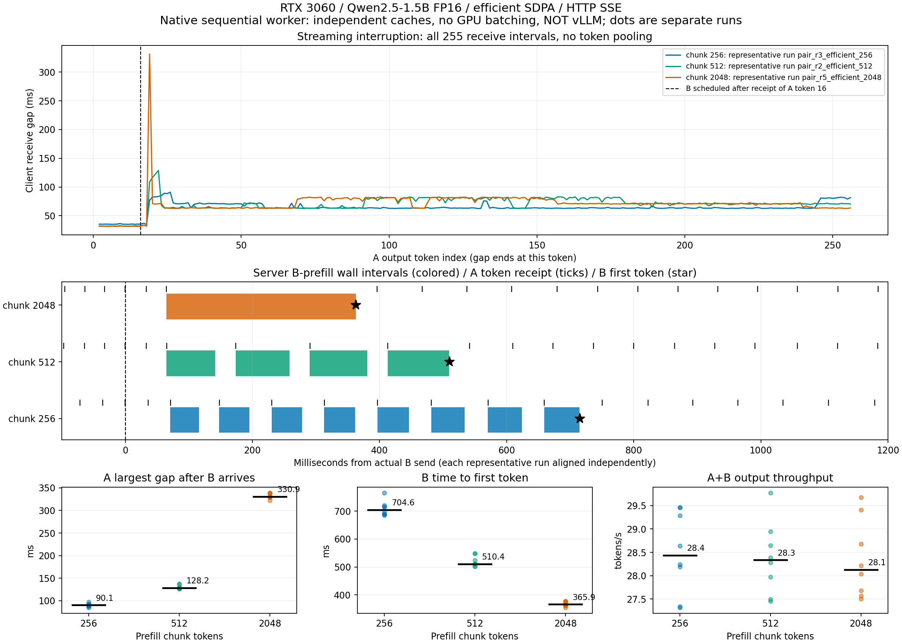

# RTX 3060에서 LLM 스트리밍 지연을 재현하고 원인을 좁힌 실험

**질문:** 짧은 질문에 답변을 스트리밍하는 도중 긴 문서 요청이 들어오면, 기존 사용자의 답변은 얼마나 끊기는가? 입력 처리를 나누면 이 공백을 줄일 수 있으며, 새 요청의 첫 응답과 전체 처리량에는 어떤 비용이 드는가?

RTX 3060 한 장에서 실제 **Qwen2.5-1.5B-Instruct FP16**을 실행하고, 클라이언트 수신 시각과 서버 실행 구간을 함께 기록했다. 긴 입력을 잘게 나누면 기존 답변의 공백은 줄었지만 새 요청의 첫 응답은 늦어졌다. 과부하에서는 실행 전 대기열이 지연을 지배해, 입력 분할만으로 해결되지 않았다.

> **범위:** 이 저장소는 Transformers/PyTorch로 작성한 Windows 네이티브 HTTP/SSE 서버의 측정 결과다. **vLLM을 사용하지 않았다.** 서버는 독립 KV cache를 가진 요청들을 순차적으로 번갈아 처리하며, continuous batching을 구현하지 않았다. 여기의 chunk는 요청별 prefill 분할 크기이고 vLLM의 전역 `max_num_batched_tokens`가 아니다. 실제 GPU batch 실험은 별도로 수행했다.

## 핵심 결과

아래 첫 표는 같은 서버에서 조건 순서를 무작위로 교차한 실험의 efficient SDPA 결과이며, 조건별 8회 중앙값이다. A는 입력128·출력256토큰, B는 입력2048·출력256토큰이고 A의 16번째 출력 수신 직후 B를 보냈다.

| Prefill chunk | 기존 요청 A의 최대 출력 공백 | 새 요청 B의 첫 응답(TTFT) | A+B 출력 처리량 |
|---:|---:|---:|---:|
| 2048 | 330.94ms | 365.88ms | 28.13 tokens/s |
| 512 | 128.23ms | 510.44ms | 28.33 tokens/s |
| 256 | 90.15ms | 704.59ms | 28.44 tokens/s |

**2048→256으로 줄이면 A 공백은 약73% 감소했지만 B의 첫 응답은 약93% 늦어졌다.** 처리량은 비슷했다. 이 조건에서 chunk 조절은 기존 사용자와 신규 사용자 사이의 지연 배분을 바꿨다.



혼합 부하는 짧은 요청80%·긴 요청20%이며, 각 설정에 동일한 도착 기록을 재생했다. 아래 각 행은 50요청×2회다. 본 측정 전에 정한 **합성 지연 목표**는 짧은 요청 TTFT≤2초, 긴 요청≤4초, 요청별 최대 출력 간격≤350ms다. 실제 업무 SLA를 뜻하지 않는다.

| 부하 | Chunk | 목표 충족 /100요청 | Goodput, 목표 충족 요청/s | 전체 output tokens/s |
|---|---:|---:|---:|---:|
| 낮은 도착률 0.08 req/s | 256 | 100 | 0.07764 | 19.8758 |
| 낮은 도착률 0.08 req/s | 512 | 100 | 0.07784 | 19.9265 |
| 낮은 도착률 0.08 req/s | 2048 | 68 | 0.05288 | 19.9084 |
| 과부하 0.24 req/s | 256 | 16 | 0.01761 | 28.1692 |
| 과부하 0.24 req/s | 512 | 8 | 0.00881 | 28.1899 |
| 과부하 0.24 req/s | 2048 | 4 | 0.00447 | 28.5760 |

처리량이 높아져도 목표를 만족한 요청은 줄 수 있었다. 최대 입장 대기 요청의 예정 TTFT 약229.59초 중 **229.31초가 실행 전 대기**, prefill 자체는 약34ms였다. 출력 간섭과 admission queue를 분리해서 봐야 하는 근거다. 두 처리량의 분모에는 마지막 요청이 끝날 때까지의 drain 시간을 포함했다.

## 무엇을 실행했는가

| 단계 | 변경한 조건 / 목적 | 본 측정 실행 수 |
|---|---|---:|
| HTTP 간섭 대조군 | A 단독·짧은 B·긴 B, math/efficient attention | 50 |
| Backend 교차 비교 | 같은 서버에서 backend 2종×chunk 3종, 8블록 | 48 |
| 혼합 부하 | 도착률 2종×chunk 3종×2회 | 12 |
| 실제 static batch·CPU·문맥 | batch1/2/4/8, CPU threads, 입력 길이 | 50 |
| Chat 입력 | 역할 구분이 있는 입력에서도 같은 현상이 재현되는가 | 15 |
| 클라이언트 프로세스 분리 | 서버와 같은 Python 프로세스라서 생긴 현상인가 | 30 |
| 동시 실행 상한 | active cap2/8이 출력 간격과 입장 대기에 미치는 영향 | 4 |
| **합계** | **HTTP 956요청 + static 105시퀀스** | **209** |

본 측정 출력은 **271,616토큰**, HTTP 오류는 **0건**이다. 이 합계에는 이전 queue 기반 실험25회, pilot, warmup, 수치 진단, profiler 실행을 포함하지 않았다. 집계별 표본과 반복 범위는 [전체 보고서](LLM_OVERNIGHT_RESULTS.md)에 있다.

추가로 확인한 사실:

- 초기 eager FP16의 NaN을 무효 처리하고 QK 중간 결과 overflow를 좁혔다. Q 사전 scaling 또는 제한적인 FP32 계산으로 유한값이 복구됐다.
- Chat 입력과 별도 클라이언트 프로세스에서도 chunk에 따른 공백·TTFT의 상충관계가 재현됐다.
- 별도 static batch1→8의 총 처리량은 약30→223 tokens/s였지만 TTFT도 증가했다. 이는 HTTP 순차 서버의 처리량이 아니다.
- active cap8→2는 실행 중 요청의 공백을 줄였지만 입장 대기를 늘려, 해당 과부하에서 goodput이 감소했다.
- 문맥 길이에 따라 실제 KV 메모리는 공식과 일치해 증가했으나, 입력128→2048에서 decode 시간의 뚜렷한 증가는 관찰되지 않았다.

## 어떻게 측정했는가

```text
HTTP 클라이언트 A ──┐
                    ├─ HTTP/SSE 서버 → 대기열 → 단일 GPU worker → Qwen 모델
A의 token16 수신    │                         A decode / B prefill chunk를 교대로 실행
       └─ 요청 B ───┘

클라이언트: 전송·token ID별 수신 시각
서버: 접수·입장·prefill/decode 실행·생성 시각
                    └─ 동일 시계로 공백과 실행 구간을 대응
```

SSE의 accepted/token/done 이벤트를 구분한다. 네트워크 패킷 수나 문자열 길이를 토큰 수로 세지 않는다. 각 요청은 입력128 또는2048, 출력256을 검증하며, EOS를 무시해 출력 길이를 통제한다. Prefix cache 재사용과 CUDA graph는 끄고, 매 forward의 logits 유한값 검사와 동기화 비용을 포함한다.

시간대별 서버 로그로 공백을 분해했고, 이전 math attention 실험의 별도 Torch CUDA profiler로 실행 순서를 확인했다. **프로파일러 실행의 지연·처리량은 성능 집계에서 제외**했다. Raw 검증은 토큰 개수, 실제 요청 중첩, A#16 트리거, 동일 도착 기록, 출력 hash, TTFT 분해와 goodput 재계산을 포함한다.

## 실행 환경과 vLLM의 위치

| 항목 | 실제 측정 환경 |
|---|---|
| GPU | NVIDIA GeForce RTX 3060, 12GiB, driver616.92 |
| OS | Windows 10 build18363, WDDM; 등록된 Linux 배포판은 WSL1 |
| Python / PyTorch | 3.11.18 / 2.7.0+cu118 |
| CUDA runtime / Transformers | 11.8 / 4.51.3 |
| 모델 revision | `989aa7980e4cf806f80c7fef2b1adb7bc71aa306` |
| 가중치·KV | FP16; attention backend를 실험별 명시 |

원래 목표는 vLLM의 토큰 예산 비교였다. 당시 실행 환경에서 공식 GPU vLLM을 바로 실행할 수 없어 Windows용 자체 구현으로 범위를 변경했다. **vLLM 설치·서빙·스케줄러 튜닝은 아직 수행하지 않았다.** 후속 과제는 WSL2 또는 Linux에서 실제 vLLM을 실행해 같은 요청으로 재검증하는 것이다. 기존 결과를 vLLM 성능 개선으로 표현하지 않는다.

한 대의 GPU, 합성 입력, 고정하지 않은 GPU clock/power 조건이다. 작은 표본의 p95는 탐색적 수치이며 p99·운영 SLA를 보장하지 않는다. Batch speedup만으로 DRAM bandwidth 병목을 입증하지 않으며, 답변의 의미적 품질도 평가하지 않았다.

## 읽는 순서와 파일 안내

| 목적 | 문서 / 파일 |
|---|---|
| 전체 수치·근거·60초 설명 | [최종 실험 보고서](LLM_OVERNIGHT_RESULTS.md) |
| 가설·통제변수·반증 조건 | [측정 프로토콜](LLM_OVERNIGHT_PROTOCOL.md) |
| 환경 준비·새 실험 실행·집계 명령 | [재현 절차](REPRODUCING.md) |
| 데이터 구분과 원시 로그 구조 | [결과 데이터 안내](results/README.md) |
| 최초 queue 실험과 profiler 근거 | [이전 실험 보고서](LLM_NATIVE_RESULTS.md) |
| HTTP 서버·클라이언트·순차 worker | [benchmark_llm_http.py](benchmark_llm_http.py) |
| 원시 검증 / 전체 집계 | [analyze_llm_http.py](analyze_llm_http.py), [summarize_llm_study.py](summarize_llm_study.py) |
| 기계 판독용 전체 결과 | [RESULTS_DATA.json](results/overnight/RESULTS_DATA.json) |

GPU 없이 기존 HTTP 결과를 검증하려면 Python 표준 라이브러리만 사용하는 다음 명령을 실행한다.

```bash
python analyze_llm_http.py results/overnight/http_mixed_load
python summarize_llm_study.py results/overnight
```

새 GPU 실험은 [재현 절차](REPRODUCING.md#reproduce-the-extended-http-campaign)를 따른다. 새 출력 디렉터리와 미래 `--deadline`을 지정하고 GPU 작업은 직렬로 실행한다. 기존 측정은 덮어쓰지 않는다.

가상환경·모델 가중치·대형 profiler 원본·임시 실행 로그는 Git에서 제외했다. 측정 JSON/CSV, 코드 snapshot, 설정, 검증 결과와 그림은 포함했다. 모델은 명시한 revision으로 별도 준비해야 한다.
